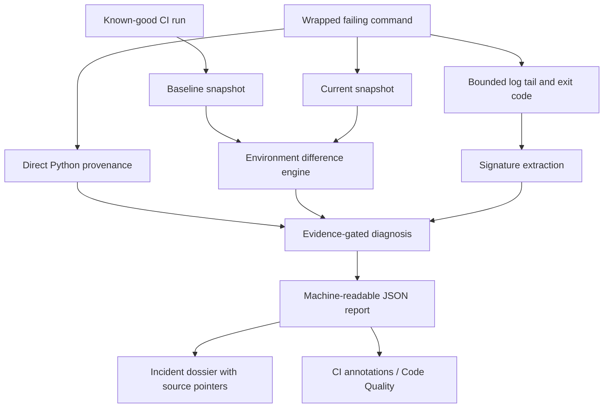

# Architecture — EnvGuard CI v0.2.0 release candidate

## Boundaries

`collection.py` probes the selected interpreter and normalizes installed package metadata; `project.py` hashes selected project configuration files. `graph.py` evaluates PEP 508/PEP 440 metadata on the inspected target interpreter with `packaging`.

`provenance.py` observes **argv[0] when it is unambiguously a Python executable** and preserves identities as hashed/redacted labels; it cannot trace nested subprocesses. `diagnostics.py` finds observed environment differences and consistency issues. `failure.py` parses bounded log-tail error signatures and associates them with available runtime evidence.

`ci.py` runs the command without a shell, streams its output, retains a bounded in-memory tail and writes snapshots/reports while propagating its return code. `incident.py` makes a deterministic, auditable dossier from the CI JSON and does **not** interpret logs as commands or apply fixes. `reporting.py` emits CI annotations or GitLab Code Quality entries; synthetic configuration anchors must not be presented as real source-code line defects.

## Evidence model

The dossier distinguishes `observation`, `supports`, `context`, and `correlation_only`. Each item has a JSON-pointer-like `source` pointing into the diagnostic report. Root-cause hypotheses remain **unverified** even when high-confidence metadata support exists; a validated repair requires separate controlled reproduction and retesting (not present in v0.2.0). The incident JSON format is versioned separately from the package; its `schema_version` remains `0.1.0`.

A snapshot fingerprint hashes normalized metadata; it is **not** a byte-level attestation. The value of a baseline comparison depends on comparing equivalent OS/architecture/runner configuration.

## Threat model

- A CI log is untrusted text. Extract only bounded signatures; don't interpret or execute user-derived text.
- A project and interpreter can execute startup/build scripts; EnvGuard is not a sandbox.
- CI runner secrets are outside the tool's controls; do not expose tokens in raw logs.
- Snapshot/report files reveal package metadata and should be treated as access-controlled build artifacts.
- Prefer explicit uncertainty to false root-cause precision.

## v0.2.0 reliability guarantees and limits

- `model.write_json` uses a private temporary file in the destination directory and `os.replace`, so interrupted writes cannot overwrite the previous complete JSON with a truncated one. This is not a durability guarantee across catastrophic hardware failure.
- If inspecting the interpreter fails, `ci-run` records `status=collection_failed`, `snapshot_available=false` and an evidence dossier when file output is possible; original nonzero command status is retained. A successful wrapped command with failed inspection returns diagnostic status 2.
- `collection.py` intentionally suppresses raw interpreter-probe stderr in its own failure message, since startup hooks may include private paths or credentials. Normal wrapped job output is still streamed to CI.
- `comparability.py` checks baseline and current OS, architecture, implementation, Python minor version and SOABI. Cross-target baselines are flagged, not silently treated as equivalent environments. They remain useful *context*, not proof of causation.
- Source and wheel builds are inspected in `scripts/verify_release.py`. `scripts/smoke_release.py` validates the installable wheel outside the checkout. These tests do not replace real runner testing or a security audit.
